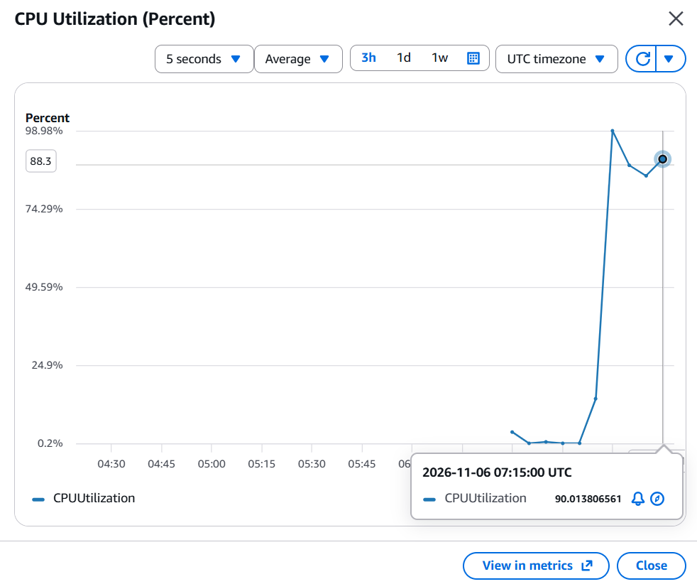
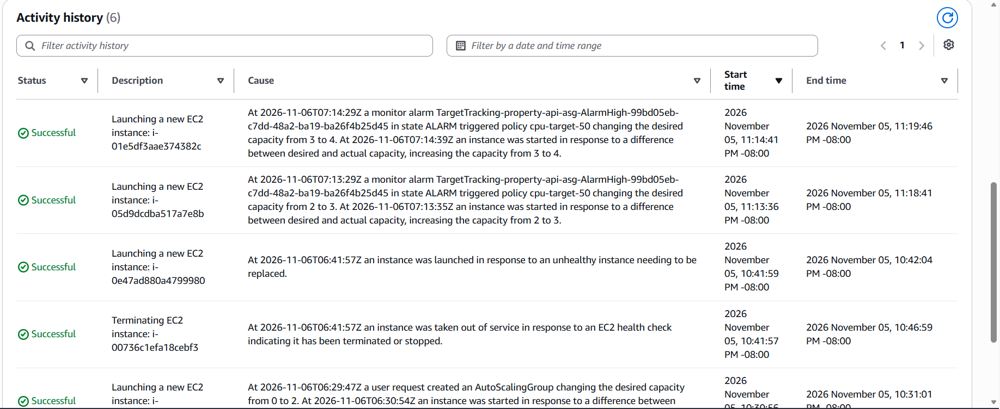

# Week 6 Load Test Report

## Summary

I tested PropertyLite behind an Application Load Balancer and an Auto Scaling Group (ASG). The ASG replaced a terminated instance automatically. It also scaled from 2 instances to its maximum of 4 under CPU load.

The first scale-out started 13 minutes 36 seconds after the first measured CPU reading above 50%. Most of that delay happened because the ASG had no dynamic scaling policy during the first part of the test. After I added the policy, the first scale-out started 7 seconds after the alarm triggered.

## Test Setup

- **Application:** PropertyLite on port 8080
- **Instance type:** t3.micro
- **ASG capacity:** desired 2, minimum 1, maximum 4
- **Instance location:** two private subnets in us-east-1a and us-east-1b
- **Scaling policy:** target tracking on Average CPU Utilization with a target of 50
- **Load tool:** `stress-ng --cpu 2`, run on both instances

## Timeline

All times are UTC on November 6, 2026.

| Time | Event |
| --- | --- |
| 06:41:57 | Terminated instance `i-00736c1efa18cebf3` was taken out of service |
| 06:41:59 | Replacement instance `i-0e47ad880a4799980` started launching |
| 06:58:45 | First stress test started |
| 07:00:00 | First measured CPU reading above 50%, about 98% |
| 07:10:06 | Second stress test started |
| About 07:13 | Dynamic scaling policy `cpu-target-50` was active |
| 07:13:29 | AlarmHigh changed desired capacity from 2 to 3 |
| 07:13:36 | First scale-out instance started launching |
| 07:14:29 | AlarmHigh changed desired capacity from 3 to 4 |
| 07:14:41 | Second scale-out instance started launching |
| 07:15:00 | CPU reading was 90.01% |
| 07:19:46 | Second scale-out activity completed |

## Timestamp Gap

- **CPU spike to first scale-out:** 07:00:00 to 07:13:36 = 13 minutes 36 seconds
- **AlarmHigh to first scale-out:** 07:13:29 to 07:13:36 = 7 seconds
- **First scale-out to second scale-out:** 07:13:36 to 07:14:41 = 1 minute 5 seconds

The CPU chart reports points in 5-minute periods, so 07:00:00 is the first measured reading above 50%. It is not the exact second that CPU crossed 50%.

## Results

CPU rose from 14.31% at 06:55:00 to about 98% at 07:00:00. It remained high during the second run and was 90.01% at 07:15:00.

During the first stress test, the ASG stayed at 2 instances because it had no dynamic scaling policy. I added target tracking policy `cpu-target-50` and ran a second stress test. CloudWatch then triggered AlarmHigh, and the ASG scaled to 4 instances.

All 4 instances reached a healthy state.

## Self-Healing Test

I manually terminated one ASG instance. The ASG started a replacement 2 seconds after taking the terminated instance out of service.
## CloudWatch Screenshots

### CPU Spike

### Scale-Out Activity

## What I Learned

- Target tracking alarms only exist when the ASG has a scaling policy.
- ASG instance health and target group health are separate checks.
- CloudWatch graph lines connect measured points, so positions between points are not extra measurements.
- Stressing only one of two instances can keep average CPU near the target, so I stressed both.
