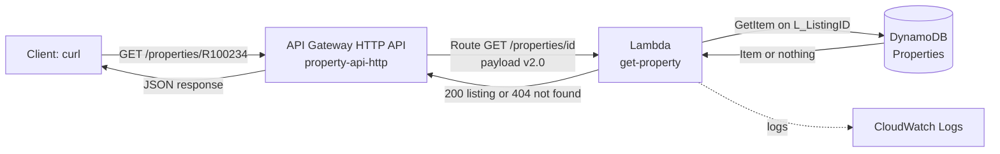

# Week 7: Serverless and Event-Driven Architecture

## Request Path

1. The client sends `GET /properties/{id}` to the API Gateway invoke URL.
2. API Gateway matches the route `GET /properties/{id}` and invokes the `get-property` Lambda function. The listing ID arrives in `event["pathParameters"]["id"]`.
3. Lambda calls `GetItem` on the `Properties` DynamoDB table, using `L_ListingID` as the key.
4. If the item exists, Lambda returns a 200 response with the listing as JSON. If it does not exist, Lambda returns a 404 response with `{"error": "not found"}`.
5. API Gateway passes the response back to the client.
6. Each invocation writes its logs to CloudWatch Logs.

There is no always-on server. Lambda only runs when a request arrives.

## Why the Lambda Role Only Reaches the Properties Table

The Lambda execution role has two permissions:

- The basic Lambda permissions that AWS created with the function, so it can write to CloudWatch Logs.
- A custom inline policy, `PropertiesGetItemOnly`, saved in `properties-getitem-policy.json`.

The custom policy allows one action, `dynamodb:GetItem`, on one resource, the `Properties` table ARN. The function only needs to read one item by its key, so it gets nothing else. It cannot scan the table, write to it, delete from it, or reach any other table in the account. This follows the same least-privilege approach as Week 2.

## Changes From the Handbook Code

- **Decimal fix:** DynamoDB returns numbers as Python `Decimal` values, and `json.dumps` cannot serialize them. I added `default=str`, so numbers are returned as strings.
- **404 response:** The handbook code returns a 200 with `{}` when a listing does not exist. I added a 404 response so it matches PropertyLite's `/properties/<listing_id>` route on EC2.
- **Content-Type header:** Responses include `Content-Type: application/json`.

## Comparison With PropertyLite on EC2

The serverless route returns the same fields as PropertyLite's `/properties/R100234` route. One difference is number formatting. DynamoDB stores numbers without trailing zeros, so `LM_Dec_3` returns `"2"` here, while PropertyLite on EC2 returns `"2.0"` from the CSV.

## Cold Start Observation

The CloudWatch `REPORT` lines confirmed two cold starts, one per execution environment:

| Invocation | Init Duration | Duration | Billed Duration |
| --- | --- | --- | --- |
| First console test (cold) | 496.58 ms | 286.12 ms | 783 ms |
| Second console test (warm) | none | 232.74 ms | 233 ms |
| First call in a new environment (cold) | 488.33 ms | 289.06 ms | 778 ms |
| Later warm calls | none | 23.21 to 259.43 ms | 24 to 260 ms |

On a cold start, Lambda first creates the execution environment and runs the code outside the handler, such as creating the boto3 DynamoDB resource. That is the Init Duration, about 490 ms here. The billed duration on those calls was about the init time plus the handler time (496.58 + 286.12 = 782.70 ms, billed as 783 ms). Warm calls reused the environment, so they had no init step and most finished in under 60 ms.

## SQS and Dead-Letter Queue

I created `property-queue` with a redrive policy that points to `property-dlq`, with `maxReceiveCount` set to 3. If a message is received 3 times without being deleted, SQS moves it to the dead-letter queue. This keeps a failing message from being retried forever and saves it for debugging.

## Files

- `lambda_function.py`: the Lambda code
- `properties-getitem-policy.json`: the inline IAM policy on the Lambda execution role
- `curl-commands.md`: the curl commands and their output
- `lambda-test-200.png`: Lambda console test for R100234, returning a 200 with the Sacramento listing
- `lambda-test-404.png`: Lambda console test for R999999, returning a 404 with `{"error": "not found"}`
- `api-test-200-404.png`: terminal output for the 200 and 404 requests through API Gateway
- `sqs-send-receive.png`: SQS queue creation, sending, and receiving a message
- `sqs-redrive-policy.png`: the redrive policy on property-queue pointing to property-dlq, with maxReceiveCount set to 3
- `cold-start-logs.png`: CloudWatch REPORT lines showing the two cold starts and the warm calls
